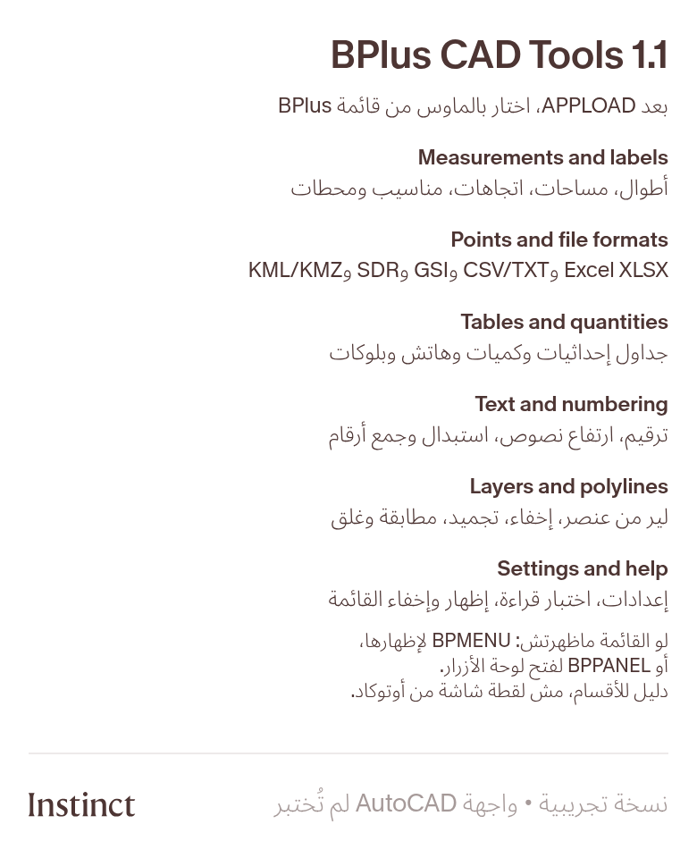

# BPlus CAD Tools 1.1

Experimental, single-file AutoLISP toolkit targeting **full AutoCAD 2021 on Windows**, with a top-level BPlus menu and a clickable tools panel. It uses ordinary AutoCAD objects inside Civil 3D, not Civil 3D COGO points or alignment APIs.

> **Trial software. AutoCAD, its UI, Windows PowerShell integration and surveying instruments have not been runtime-tested for this release. Use a drawing copy and known control points before relying on results. Labels and tables are static.**

[الدليل العربي الكامل](BPlus-CAD-Tools-1.1-Readme-AR.txt)

## Install

1. Download and extract the ZIP attached to release `v1.1`, or download `BPlus-CAD-Tools-1.1.lsp` from this repository.
2. Open a **copy** of a drawing in full Windows AutoCAD. AutoCAD LT 2021 and Mac are not supported targets.
3. Run `APPLOAD` and select the `.lsp` file. If using the WhatsApp-friendly `.lsp.txt` copy, remove only the final `.txt` extension first.
4. Loading attempts to add a **BPlus pull-down menu at the top** and show the menu bar. Pick a tool with the mouse.
5. If the menu does not appear, run `BPMENU`. `BPPANEL` opens an alternative button dialog. `BPHELP` lists all commands. `BPTEST` checks the basic parser only, not CAD execution.
6. Use `BPSET` to set text height and displayed decimal places.

For automatic loading, keep the file in a permanent folder, then use **APPLOAD > Startup Suite > Contents > Add**. Remove an older 1.0 Startup Suite entry before adding 1.1. Check both a restart and a new drawing. A workspace change may require `BPMENU` again. Do not disable `SECURELOAD`; use an appropriate trusted folder or ask your administrator.

`BPMENUOFF` hides only the BPlus menu. There is no manual CUI editing, separate icon installation, automatic startup-file editing or explicit CUI/workspace save in the toolkit.

## Tools

| Group | Commands |
| --- | --- |
| Measurements and labels | `BPLEN` polyline length totals, `BPLL` length leaders, `BPAL` closed 2D area leaders, `BPCO` coordinate leaders, `BPBEAR` azimuth/distance leaders, `BPSLOPE` distances and slope, `BPLEVEL` spot elevations, `BPCHAIN` chainage labels |
| Points and file formats | `BPIN` point import, `BPXL` Excel XLSX import, `BPOUT` POINT export, `BPCONV` point-file conversion, `BPVERT` vertex export, `BPGEO` KML/KMZ geometry export, `BPSETZ` set POINT Z, `BPSHIFTZ` shift POINT Z |
| Tables and quantities | `BPCOTAB` coordinate table, `BPPLTAB` polyline quantities, `BPHATCH` hatch area total/table, `BPCOUNT` block reference counts, `BPATTOUT` editable attribute CSV |
| Text and numbering | `BPNUM` sequential click labels, `BPTSUM` numeric text totals, `BPTHEIGHT` text heights, `BPTREPLACE` literal plain-TEXT replacement, `BPTINC` numeric plain-TEXT offsets |
| Layers and polylines | `BPLAY` current layer from pick, `BPLAYOFF` layer off, `BPLAYFREEZE` freeze, `BPLAYMATCH` match layer, `BPCLOSE` close ordinary polylines |
| Settings and help | `BPSET`, `BPTEST`, `BP`, `BPHELP`, `BPMENU`, `BPMENUOFF`; `BPPANEL` opens the fallback panel |



## File formats and coordinates

- **CSV/TXT:** select column order using `P` point ID, `E` easting/X, `N` northing/Y, `Z` elevation and optional `D` description. E/N/Z are mandatory; P/D are optional. Comma, semicolon, tab and space separators are supported, with an explicit header choice. Use dot decimals, not thousands separators. Output quotes IDs/descriptions. Check that the receiving software accepts its output conventions.
- **Excel:** `BPXL` reads ordinary Transitional `.xlsx` directly without opening or installing Excel. Choose a worksheet and map column letters in P/E/N/Z/D order. Formula cells are rejected; paste values into a copy first. It uses underlying values, not display formatting. Legacy `.xls`, `.xlsm`, encrypted workbooks, Strict XLSX and XLSX export are not supported. Save a trusted legacy workbook as ordinary `.xlsx` first.
- **Leica GSI:** strict metric Cartesian GSI8/GSI16 coordinate records `11/81/82/83`, optional `71`. Input metric codes 0/6/8; output 0.001 m precision. No raw observations or station-record reduction. Field widths and leading-zero ambiguity are checked rather than silently truncating text.
- **SDR:** metric SDR33 `08` coordinate records with a valid N-E-H header. Known non-08 records are counted as ignored, not reduced. Not SDR20/22. Output precision is 0.0001 m.
- **KML/KMZ:** explicit WGS84 UTM zone/hemisphere or X=longitude/Y=latitude selection and confirmation each time. No automatic Map/Civil CRS detection, local-datum transform or geoid/vertical-datum conversion. Point-only import. Export supports points and sampled polyline LineStrings, not filled polygons. Default export clamps to terrain; default import explicitly uses Z=0. Absolute heights need known, correct altitude semantics.

WCS coordinates use **E=X and N=Y**, independent of the current UCS. Ordinary measurements use drawing units and square drawing units, without assuming meters. Survey drawing commands require Model space or an active model viewport.

Advanced file formats use an embedded, temporary **local Windows PowerShell** helper for ZIP, XML and coordinate math. It requests no network access, launches no Excel process and does not load KML network links. It uses a process-scoped execution-policy override, not a permanent policy change; enterprise policy may still block it. Do not weaken company security settings to make it run. CAD and delimited-file commands are independent of that helper.

Point IDs/descriptions are printable ASCII in this release. General point-file operations are limited to 20,000 points/samples. Advanced-format input files are limited to 32 MiB. See the Arabic guide for exact supported subsets and limitations.

## Important behavior

- Labels and tables do **not** update when their source geometry changes.
- Imported survey points are ordinary AutoCAD `POINT` entities with ID/description XData, not COGO points.
- Polyline chainage uses curve length, including 3D slope length. It is not a Civil alignment or station-equation system.
- Layer off/freeze affects the entire layer. The current layer, layer 0 and Defpoints are protected by those tools.
- Hatch areas count overlaps separately. Block counts do not expand nested blocks; an MINSERT counts as one selected reference.
- Text replacement operates on plain single-line TEXT, not MTEXT, attributes or fields. Numeric text edits do not retain original number formatting.
- Selected-object mutations ask for confirmation; affected point/text/close routines check locked layers before editing. Use `U` to undo drawing additions/edits if needed. Exported files are not covered by drawing undo.
- Output uses new filenames; existing files are not overwritten. No automatic purge, audit, overkill, general join or duplicate-vertex cleanup is included.

## Verification

Source structure, internal command targets and generated dialog structure were checked. Pure parser, CSV, azimuth and literal-replacement cases were tested separately. The local file-processing helper passed fixture tests for survey formats, KML/KMZ, XLSX and malformed inputs. Sample WGS84/UTM calculations were compared with an independent projection implementation.

These checks **do not establish AutoCAD or instrument compatibility**. This release has not been loaded or visually inspected inside AutoCAD 2021 or Civil 3D, and Windows PowerShell 5.1 launching, menu/dialog rendering, CAD edits, tables and actual instrument transfers remain untested. The Arabic guide marks each new command's verification level. The menu image is an authored guide, not evidence of a running AutoCAD session.

## Files and integrity

- `BPlus-CAD-Tools-1.1.lsp`: single source file.
- `BPlus-CAD-Tools-1.1.lsp.txt`: identical copy for channels that reject `.lsp` attachments.
- `BPlus-CAD-Tools-1.1-Readme-AR.txt`: full Egyptian Arabic guide and per-command caveats.
- `BPlus-CAD-Tools-1.1-Menu-Guide.png`: menu section guide.
- `SHA256SUMS.txt`: file checksums.

SHA-256 of both code copies:

```text
f79fa28910103528de6931125c91d6def1a603ee8dc9e9cbf3a5f4b017baa491
```

## بالعربي

نسخة تجريبية لأوتوكاد الكامل 2021 على ويندوز. بعد `APPLOAD` المفروض تظهر قائمة **BPlus** فوق، وتختار الأداة بالماوس. لو ماظهرتش جرّب `BPMENU`، أو `BPPANEL` للوحة الأزرار. للتحميل التلقائي: `APPLOAD > Startup Suite > Contents > Add`، واحفظ الملف في مكان ثابت، وشيل نسخة 1.0 القديمة من Startup Suite لو موجودة.

الأدوات تشمل الأطوال والمساحات والإحداثيات والمناسيب والمحطات والجداول والنصوص والليرات والبلوكات، واستيراد نقاط من **XLSX** مباشرة من غير Excel. اختار الشيت وحروف الأعمدة وراجع المعاينة قبل إضافة النقط. ملفات XLS القديمة تتحفظ XLSX الأول؛ الخلايا اللي فيها معادلات تتعمل لها Paste Values في نسخة.

**جرّب على نسخة من الرسم ونقط كنترول معروفة. التشغيل داخل AutoCAD وجهاز المساحة لسه مش متجرب. الليدرات والجداول ثابتة، وGoogle Earth محتاج تأكيد نظام WGS84 الصحيح كل مرة. مفيش تحويل Datum محلي أو مناسيب جيوديسية.**

راجع [الدليل العربي الكامل](BPlus-CAD-Tools-1.1-Readme-AR.txt) لكل أمر وحدود الصيغ ومستوى التحقق.

## References

Routine categories were informed by the [Lee Mac program index](https://lee-mac.com/programs.html). The toolkit's implementations are original; it does not redistribute those third-party LISP files or claim all their features.

Format and API references are listed in the Arabic guide, including Leica GSI, SDR33, KML, Autodesk ActiveX menus and Microsoft SpreadsheetML. Instrument-specific dialects can require changes even when they use the same file extension.
